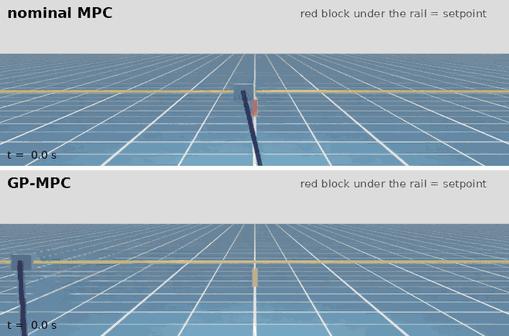
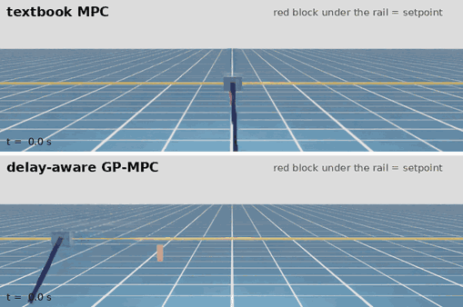

# Cart-pole NMPC and GP-MPC

An acados NMPC for cart-pole swing-up, extended with a sparse Gaussian
process that learns what the textbook model gets wrong from closed-loop
data. The GP mean goes inside the MPC model; nothing else changes.



Isaac Sim (RTX). Top: textbook MPC. Bottom: GP-MPC. NVIDIA's cart-pole
with a hidden worn motor (gain 0.65) and rail friction; the red block is
the position setpoint.

## Results

Each test is 10 episodes: a swing-up from hanging, then cart-position
steps of +1 m, −1 m and 0 m.

| | Textbook MPC | GP-MPC |
|---|---|---|
| Isaac Sim, worn motor + friction: pole fell | 10 / 10 | **0 / 10** |
| MuJoCo, strong mismatch: pole fell | 10 / 10 | **0 / 10** |
| MuJoCo, medium mismatch: settled position error | 0.37 m | **0.04 m** |
| Feedback solve time | 0.3 ms | 0.4 ms |

On the medium plant, GP-MPC also beats an MPC given the true masses, gain
and viscous friction (0.13 m), because it learns the Coulomb friction that
a smooth physics model can't include. Full tables:
[gp_mpc/results/RESULTS.md](gp_mpc/results/RESULTS.md).

## How it works

- **Residual.** The velocity error the textbook model makes in one step,
  learned from (sin θ, cos θ, vx, ω, u). It is added to vx and ω, and as
  Δt/2 times that to px and θ.
- **Sparse GP (DTC).** 300 inducing points chosen farthest-first, so the
  fast swing-up states are covered. The weights are fitted on all the
  data. The zero prior mean means that away from data the model falls
  back to physics.
- **Data.** The nominal MPC with 10 N of force noise, and half the
  episodes started from random states.
- **In the MPC.** The GP mean is a CasADi expression inside the acados
  model, solved with SQP-RTI.

Following Hewing, Kabzan & Zeilinger, *Cautious MPC using GP regression*
(TCST 2020), and Torrente et al., *Data-Driven MPC for Quadrotors* (RA-L
2021).

## Dead time



With commands acting late, a GP alone can't help: its inputs don't
include past forces.

- `delay.py` identifies the delay from data by least squares over
  candidate delays.
- It carries the commands still in the pipe as extra MPC states.
- The GP learns the rest.

| Pole fell (of 10) | 40 ms | 80 ms | 120 ms | 160 ms | Isaac, 80 ms |
|---|---|---|---|---|---|
| Textbook MPC | 10 | 10 | 10 | 10 | 10 |
| GP-MPC, delay not modelled | 10 | 10 | 10 | 10 | 10 |
| **Delay-aware GP-MPC** | **1** | **0** | **0** | **0** | **0** |

The delay was identified exactly in every case.

## Run it

```bash
python -m venv .venv && .venv/bin/pip install numpy==1.26.4 scipy matplotlib casadi==3.7.2 mujoco scikit-learn
.venv/bin/pip install -e $ACADOS_SOURCE_DIR/interfaces/acados_template
cd gp_mpc
../.venv/bin/python run_experiments.py --scenario strong      # MuJoCo, ~4 min
../.venv/bin/python delay_experiments.py --delay 2            # dead time, ~4 min
# Isaac Sim: start the plant server, then the same scripts with the Isaac option
cd ~/isaacsim6 && ./python.sh ~/cartpole_mpc/gp_mpc/isaac_server.py --gear 0.65 --rail-viscous 4 --rail-coulomb 3.5
../.venv/bin/python run_experiments.py --scenario isaac --rounds 1 --n-train 24
```

`isaac_server.py --render` with `isaac_validate.py` records the Isaac
videos.

| File | |
|---|---|
| `cartpole_model.py`, `cartpole_ocp.py`, `cartpole_closed_loop*.py`, `cartpole_isaacsim.py` | base NMPC (Diehl NOC course, exercise 10) |
| `gp_mpc/run_experiments.py` | data, GP fit, closed-loop evaluation |
| `gp_mpc/residual.py` | residual dataset, sparse GP, baselines (boosting, forest, MLP) |
| `gp_mpc/mpc.py`, `dynamics.py`, `plants.py` | acados OCP, cart-pole model, MuJoCo / Isaac plants |
| `gp_mpc/delay.py`, `delay_experiments.py` | dead-time identification and delay-aware MPC |
| `gp_mpc/isaac_server.py`, `isaac_validate.py` | Isaac Sim plant server, rendered validation |
